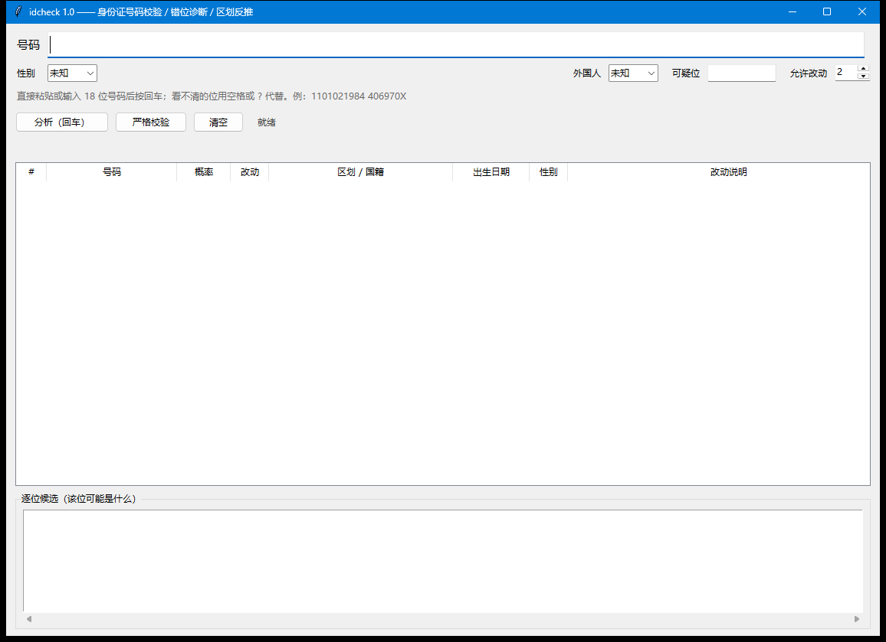

# IDcheck —— 身份证号码校验、错位诊断与区划代码反推

针对**他人手抄/OCR 转录**的身份证号码：可以判断对错，且能指出**哪一位错、错成什么**，并逐位给出可能的取值。

| 形态 | 路径 | 说明 |
| --- | --- | --- |
| **文件夹版（推荐）** | `IDcheck/IDcheck.exe` | 启动即开、不碰 `%TEMP%`，双击就有窗口 |
| 压缩包 | `IDcheck-2026-10-29_0330-win64.zip` | 文件夹版的 zip，拷到别的机器解压即用 |
| 单文件版 | `dist/idcheck-single.exe` | 只拷一个文件方便，但每次启动要解压到 `%TEMP%`；`%TEMP%` 不可写时会启动即退出 |

---

## 1. 能做什么

| 场景 | 用法 | 输出 |
| --- | --- | --- |
| **双击 exe** | 双击 `IDcheck.exe` | 打开**图形界面**，粘贴号码回车即出结果 |
| 号码是否合法 | `IDcheck check 11010219840406970X` | 校验码、地址码、出生日期、顺序码、性别逐项结论（JSON） |
| 手抄号码有错位/污损 | `IDcheck analyze <号码>` | 候选号码排序 + 每一处错位点 + 逐位候选字符 |
| 一次处理多行 | `IDcheck analyze --stdin` | 每行一个号码，逐行输出 |
| 纯文本界面 | `IDcheck --console`（或 `-i`） | 命令行窗口里的交互式输入 |

### 双击进入的图形界面



双击 `IDcheck.exe` 直接弹出窗口（不再有控制台窗口），上方填号码，下方是候选表格与逐位候选：

- **分析（回车）**：跑完整的错位识别与反推，结果填进表格；
- **严格校验**：只判合法与否，输出 JSON；
- 顶部可设性别、是否外国人、可疑位、允许改动数，改完下一条立即生效；
- 分析在后台线程跑，界面不冻结；`Esc` 退出。

**附带的控制台黑窗口默认隐藏**，只留 GUI。做法是 `user32!ShowWindow(hwnd, SW_HIDE)`
而不是 `FreeConsole()`：单文件 exe 是"引导进程 + 子进程"两个进程共用同一个控制台，
子进程 `FreeConsole()` 之后引导进程仍持有它，黑窗口不会消失 —— 这正是最初关不掉的原因。
隐藏前先查该控制台挂了几个进程，只有 1–2 个（本次启动专用的控制台）才动手；
从已有终端启动时不会动你的终端窗口。

打包成 exe 后仍完整保留命令行用法（`check` / `analyze` / `demo` / `--stdin`），
图形界面只是"无参数启动"时的默认行为——这正是双击时的情况。

### 纯文本交互（`--console`）

不想用图形界面时：

```
号码> 1101021984 406970X

最可能  11010219840406970X   96.5%
        北京市西城区 · 1984-04-06 · 女 · 校验码正确
...
号码> q
已退出。
```

文本交互中可随时改设置，下一条号码立即生效：

| 命令 | 作用 |
| --- | --- |
| `check <号码>` | 只做严格校验，输出 JSON |
| `gender 男` / `女` / `未知` | 设定输入者提供的性别 |
| `foreign 是` / `否` / `未知` | 是否为外国人永久居留身份证 |
| `suspect 15,16` | 只看这些位是否可能错（更快更准）；单独 `suspect` 清空 |
| `edits 2` | 允许几处局部改动 |
| `help` / `q` | 帮助 / 退出 |

`analyze` 的核心产出是三样：

1. **最可能号码**：一句结论（区划 · 出生 · 性别 · 校验码）+ 概率。
2. **候选号码表**：按概率排序，`^` 标出与输入不同的位，右边写明改动（如 `第15、16位颠倒 97→79`）。
3. **逐位候选**：第 1–18 位逐一列出可能的字符及其占比 —— 即"把可能的号码提供在对应位数下方"。

---

## 2. 输入约定

| 写法 | 含义 |
| --- | --- |
| `11010219840406970X` | 正常号码 |
| `1101021984 406970X` | 空格 = 这一位看不清/缺失（也可写成 `?`） |
| `1101021984 406970X`（不加引号） | 命令行会把空格当分隔，程序仍会按"缺位"拼接 |
| `O` `o` `〇` `I` `l` `\|` `×` `x` | 自动按 `0` `0` `0` `1` `1` `1` `X` `X` 处理 |
| `--suspect 15,16` | 输入者指出可疑的位（从 1 起）。给出后只在指定位附近找错位，**更快也更准** |

> 手抄件建议先用 `--suspect` 问清"哪几位看不清"，再跑分析：搜索空间会从 7 万种读数降到几百种。

---

## 3. 可选信息（可询问输入者）

| 参数 | 取值 | 作用 |
| --- | --- | --- |
| `--gender` | `男` / `女` / `未知` | 顺序码末位奇男偶女；与给定不符的候选概率降到 2% |
| `--foreign` | `是` / `否` / `未知` | 是否为 2023 版外国人永久居留身份证 |
| `--p-foreign` | 0–1，默认 0.02 | 事先认为对象是外国人的概率 |
| `--p` | 0–1，默认 0.97 | 每一位抄对的概率 |
| `--edits` | 默认 2 | 最多允许几处局部改动（3 会明显变慢） |

**关于外国人证件**：公民身份号码的省级代码不以 9 开头，所以**首位一见 9** 就把永居证的先验抬到 0.9 并给出提示；否则维持 2% 的低先验。也就是说，只有在"前序代码已经把范围收窄到 9 开头"时，才值得去问国籍。

---

## 4. 怎么算的

### 4.1 校验码

18 位号码第 18 位由前 17 位唯一决定：

$$c=\left(12-\left(\sum_{i=1}^{17}a_i W_i \bmod 11\right)\right) \bmod 11,\quad W_i=2^{18-i} \bmod 11$$

权重依次为 `7 9 10 5 8 4 2 1 6 3 7 9 10 5 8 4 2`，$c=10$ 记作 `X`。

这条式子的用处不只是"验对错"：它是一条模 11 的**线性方程**。固定其余位后，任意一位上的正确值都被唯一确定 —— 这就是"反推"的数学基础。给定其余 16 位，第 $k$ 位应改成

$$a_k'=\left(a_k-\omega\cdot W_k^{-1}\right)\bmod 11,\qquad \omega=\sum_{i=1}^{17}a_iW_i \bmod 11$$

每个位置**恰好一个解**，因此"这一位该改成什么"是可算的，不需要瞎猜。

### 4.2 错位：枚举"读数"

手抄件的问题不只是某位数字错，而是**粘连、漏抄、多抄**会让后面整体错位。程序把输入串解释成号码的每一种方式称为一个**读数**，允许六种局部改动：

| 改动 | 含义 | 例子 |
| --- | --- | --- |
| 原样 | 该字符就是该位的值 | — |
| 替换 | 该位实际是别的字符 | `3` 写成 `8` |
| 插入 | 漏抄一位，号码该位有值 | `…970X` 抄成 `…97X` |
| 删除 | 多抄一位 | `…970X` 抄成 `…9700X` |
| 换位 | 相邻两位颠倒 | `84` 抄成 `48` |
| 合并 | 两位粘成一位，读作前者或后者 | `44` 粘成 `4` |

每个读数按概率计权：

$$P(\text{读数})=\prod_{\text{原样}}p\;\cdot\prod_{\text{替换}}\frac{1-p}{10}\;\cdot\prod_{\text{插入}}q_{\text{ins}}\;\cdot\prod_{\text{删除}}q_{\text{del}}\;\cdot\prod_{\text{换位}}q_{\text{swap}}\;\cdot\prod_{\text{合并}}q_{\text{merge}}$$

默认 $p=0.97$，$q_{\text{ins}}=q_{\text{del}}=0.01$，$q_{\text{swap}}=q_{\text{merge}}=0.02$，缺位 $q_{\text{blank}}=0.03$。

读数与号码不是一一对应：读数的前 17 位确定后，第 18 位由校验公式给出；若读数里的第 18 位与公式不符，就记一次"校验位抄错"的替换。于是

- **"某位前缀抄错"** 由替换/换位/合并的读数覆盖；
- **"校验位抄错"** 由"第 18 位改成公式值 + 罚一次替换"覆盖；

两种解释同权竞争，由结构先验决出胜负。

### 4.3 结构先验

号码不是随机的：区划码要在库里、出生日期要合法、**区划代码要与出生年相容**。设权重

$$\text{先验}=\begin{cases}4 & \text{区划命中且出生年在代码有效期内}\\ 2 & \text{出生日期合法}\\ 1 & \text{顺序码完整}\end{cases}\qquad\text{任一项不成立}\Rightarrow\times 0.04$$

区划时效按"出生年是否落在代码的启用—废止区间"判定，边界年（恰为启用年或废止年）乘 0.5：

- 出生年 **早于** 代码启用年 → 不可能；
- 出生年 **晚于** 代码废止年 → 不可能（这正是"新生儿的出生年一定不会用一年前的旧区划代码"）；
- 恰为废止当年 → 过渡期，降权保留。

例如崇文区 `110103` 2010 年废止：2009 年出生有效、2010 年出生降权、2011 年出生直接判为不可能。

### 4.4 输出概率

把全部合法读数的号码归一化：

$$P(\text{号码})=\frac{e^{w}}{\sum_{\text{全部候选}}e^{w}},\qquad w=\log P(\text{读数})+\log(\text{结构先验})$$

---

## 5. 输出示例

```
输入  1101021984 406970X
识别  1101021984 406970X
读数  68427 种错位解释 → 132386 个候选号码，用时 2.28 s

最可能  11010219840406970X   96.5%
        北京市西城区 · 1984-04-06 · 女 · 校验码正确
        改动：—

候选号码（按可能性排序；^ 标出与输入不同的位）
#   号码                 概率     改   区划 / 国籍        出生日期        性  改动说明
1   11010219840406970X 96.5%  0   北京市西城区         1984-04-06  女  —
2   11010219841206970X 0.3%   1   北京市西城区         1984-12-06  女  第12位 4→2
...
逐位候选（概率 = 该位上各候选字符在全部候选号码中的占比）
位   输入  候选字符（占比）
1    1     1 99.9%   3 <0.1%   5 <0.1%   2 <0.1%   〔地址码〕
...
18   X     X 99.1%   0 0.2%   7 0.1%   8 0.1%   〔校验码〕
```

`check` 输出 JSON，`ok` 为 `true` 时退出码 0，否则 1（便于脚本批处理）。

---

## 6. 性能

| 输入 | 读数 | 候选 | 耗时 |
| --- | --- | --- | --- |
| 18 位完整号码 | 78 707 | 15 190 | 0.4 s |
| 含一处空格缺位 | 68 427 | 132 386 | 2.3 s |
| 加 `--suspect 16` | 277 | 100 | 0.01 s |

（IntelliJ 之外的普通桌面 CPU，单线程纯 Python；exe 启动另有约 1 s 自解压。）

---

## 7. 目录结构

```
idcheck/
├─ idcheck.py                 主程序（只用标准库）
├─ idcheck_gui.py             图形界面（tkinter，同样是标准库）
├─ docs/gui.png               界面截图
├─ data/
│   ├─ idcheck_tables.txt     省级 + 县级区划表（含启用/废止年）
│   ├─ country_codes.txt      ISO 3166-1 数字代码（273 条，现行分配）
│   ├─ 行政区划代码.txt        原始资料（GB/T 2260 历年版本）
│   └─ 国家代码.txt            原始资料（ISO 3166-1）
├─ tools/
│   ├─ parse_admin_codes.py   原始 wikit 表 → data/idcheck_tables.txt
│   ├─ parse_country_codes.py 原始表 → data/country_codes.txt
│   └─ build_exe.py           重新打包 exe
└─ tests/selftest.py          自检（29 项断言）
```

原始资料里有两处格式例外已经处理：`133100 雄安新区`、`330113 临平区`、`330114 钱塘区` 三行是一格一行而非 `||` 分隔；另有 14 行标注"未曾使用"，其名称从未分配给该代码，已剔除。

---

## 8. 重新构建

```powershell
# 1) 从原始资料重建数据表
python tools/parse_admin_codes.py
python tools/parse_country_codes.py

# 2) 自检
python tests/selftest.py

# 3) 打包 exe（脚本会自动带上 --hidden-import idcheck_gui 与 tkinter）
python tools/build_exe.py
```

`tools/build_exe.py` 用的是装在 `.build/pylib` 里的 PyInstaller（不污染系统 Python）；
若该目录不存在，先执行：

```powershell
python -m pip install --target .build\pylib pyinstaller
```

打包后无参数启动走图形界面，带子命令则走命令行，两者共用同一份分析代码。

如果双击后仍然没有窗口，把 exe 旁边的 startup.log（或 %LOCALAPPDATA%\idcheck\startup.log）发我：里面记录了每次启动的 pid、是否 frozen、控制台是否被隐藏、以及 GUI 失败的完整 traceback。

---

## 9. 已知边界

- **候选数量上限**：`--edits 2` 时约 8 万种读数；`--edits 3` 会到百万级，交互上不可取，请配合 `--suspect` 使用。
- **最小改动未必是唯一解释**：一处漏抄可在 17 个位置补入，各自都只是"一个候选"，程序会并列给出，这正是需要 `--suspect` 的原因。
- **区划库是历史全量**（6 893 条，现行 3 481 条），已按出生年做时效判定；但库中不含"乡级"代码，也不含代码被撤销后又被重新启用的极少数情况。
- **外国人永居证**只按 2023 版的"9 | 申领地 | 国籍"三段结构校验，顺序码规则沿用公民号码（末位奇男偶女）。
